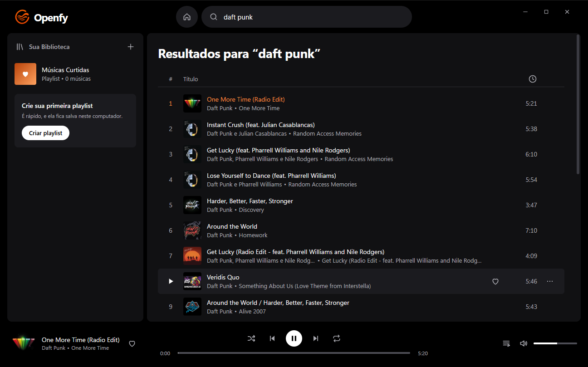
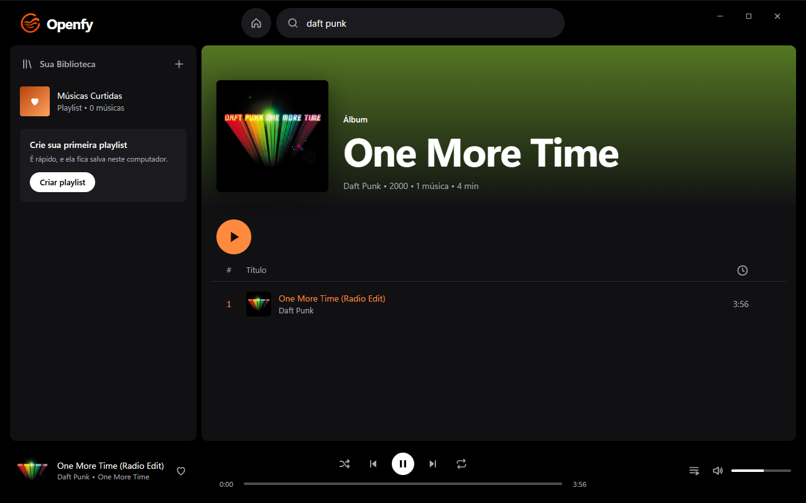
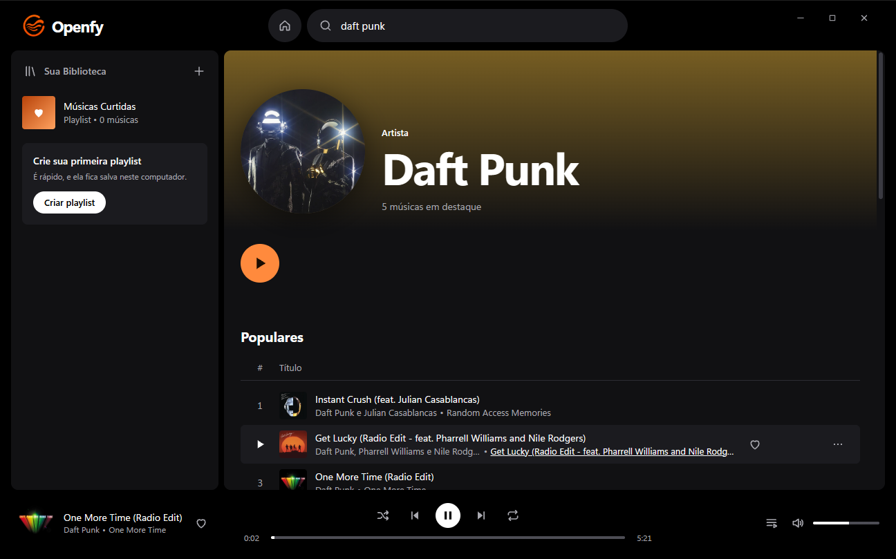

<div align="center">


# Openfy

**Player de música para desktop, leve e de código aberto, feito em Rust.**

Busca, páginas de álbum e artista, fila, rádio automática e biblioteca local — o áudio vem do [yt-dlp](https://github.com/yt-dlp/yt-dlp).

[](https://github.com/LucianoBarral/openfy/actions/workflows/ci.yml)
[](https://github.com/LucianoBarral/openfy/releases/latest)
[](LICENSE)

[Baixar](https://github.com/LucianoBarral/openfy/releases/latest) · [Reportar um bug](https://github.com/LucianoBarral/openfy/issues/new/choose) · [Contribuir](CONTRIBUTING.md) · [English](#english)



 

</div>

## O que ele faz

- **Busca com sugestões** — as sugestões aparecem enquanto você digita; Enter faz a busca completa, com abas para músicas, álbuns e artistas.
- **Salvar álbuns e seguir artistas** — eles ficam na sua biblioteca e no início.
- **Letras sincronizadas** — a letra acompanha a música (tecla `L`); clique em uma linha para pular até ela.
- **Início personalizado** — tocadas recentemente, mais tocadas, seus artistas mais ouvidos e mixes, tudo calculado do seu histórico local.
- **Retoma de onde parou** — faixa, posição e fila voltam quando você abre o app.
- **Teclas de mídia e atalhos** — o teclado e os controles de mídia do sistema comandam o player (veja [Atalhos](#atalhos)).
- **Catálogo de verdade** — cada faixa vem com título, artista, álbum e capa quadrada, sem "(Official Video)" nem resultados repetidos.
- **Páginas de álbum e de artista** — clique no artista ou no álbum de qualquer faixa (ou no player) para ver a lista de faixas, as músicas populares, os álbuns e os singles.
- **Play imediato** — a URL de áudio das faixas visíveis é resolvida antes do clique, então a música começa sem espera.
- **Fila de verdade** — só entra na fila o que você coloca nela ("Tocar a seguir" e "Adicionar à fila").
- **Rádio automática** — quando a fila acaba, o Openfy continua com faixas parecidas, sem repetir o que já tocou.
- **Biblioteca local** — músicas curtidas, playlists e histórico ficam em um arquivo JSON no seu computador.
- **Controles completos** — ordem aleatória, repetir, avançar/voltar, barra de progresso, volume e mudo.
- **Atualização automática** — cada release nova do GitHub é baixada e instalada sozinha.
- **Sem conta, sem telemetria** — o app só fala com o YouTube (catálogo, sugestões e, pelo yt-dlp, o áudio), com o [LRCLIB](https://lrclib.net) (letras: envia título, artista, álbum e duração da faixa) e com o GitHub (para se atualizar e baixar o yt-dlp).

## Instalação

> Hoje o Openfy é distribuído para **Windows 10/11 (x64)**. O código é Tauri e portável; builds para Linux e macOS são bem-vindos como contribuição.

Baixe o instalador `Openfy_x.y.z_x64-setup.exe` na [última release](https://github.com/LucianoBarral/openfy/releases/latest) e execute.

O instalador ainda não tem certificado de assinatura de código do Windows, então o SmartScreen pode mostrar um aviso na primeira execução ("Mais informações" → "Executar assim mesmo").

### yt-dlp

Você não precisa instalar o yt-dlp. Ao abrir, o Openfy baixa o binário oficial da [última release do yt-dlp](https://github.com/yt-dlp/yt-dlp/releases/latest) para a pasta de dados do app (`%APPDATA%\dev.openfy.app\bin`) e confere de novo a cada 24 horas, baixando só quando há versão diferente.

- O arquivo baixado só é usado se o SHA-256 bater com o `SHA2-256SUMS` da mesma release. Isso detecta download corrompido ou incompleto; como a lista de hashes vem do mesmo lugar que o binário, **não** é uma verificação independente de autenticidade — a confiança está no GitHub do yt-dlp, por HTTPS.
- Enquanto o download não termina (ou se ele falhar), o Openfy usa o `yt-dlp` do `PATH`, se houver. Um aviso na barra de cima mostra o andamento e permite tentar de novo.
- Para usar o seu próprio yt-dlp, defina `OPENFY_YTDLP` com o caminho completo do executável. Nesse caso o Openfy não baixa nem troca nada.

## Atalhos

| Tecla | Ação |
| --- | --- |
| `Espaço` | Tocar / pausar |
| `←` / `→` | Voltar / avançar 5 segundos |
| `Ctrl+←` / `Ctrl+→` | Faixa anterior / próxima |
| `Ctrl+↑` / `Ctrl+↓` | Volume |
| `M` | Mudo |
| `L` | Letra |
| `Q` | Fila |
| `S` / `R` | Ordem aleatória / repetir |
| `F` | Curtir a faixa atual |
| `Ctrl+K` ou `/` | Ir para a busca |

As teclas de mídia do teclado (tocar/pausar, anterior, próxima) e os controles de mídia do sistema também funcionam.

## Atualização automática

Ao abrir (e depois a cada 6 horas) o Openfy consulta o arquivo `latest.json` da última release deste repositório. Havendo versão nova, ele baixa o instalador em segundo plano e confere a **assinatura digital** contra a chave pública embutida no app — um pacote que não foi assinado pelo projeto é recusado.

- Sem nada tocando: instala e reinicia na hora.
- Com música tocando: aparece o botão **"Reiniciar para atualizar"** na barra de cima, e você escolhe o momento.

Os detalhes de como uma release é gerada estão em [docs/RELEASING.md](docs/RELEASING.md).

## Compilando do código-fonte

Pré-requisitos: [Rust](https://rustup.rs) (stable), yt-dlp no `PATH` (ou em `OPENFY_YTDLP`) e, no Windows, o WebView2 (já vem no Windows 11). Builds de desenvolvimento não baixam o yt-dlp sozinhos; `OPENFY_YTDLP_MANAGE=1` liga esse download para testar.

```powershell
git clone https://github.com/LucianoBarral/openfy.git
cd openfy/src-tauri
cargo run
```

Não há etapa de build de front-end: a interface é HTML, CSS e JavaScript puros em `ui/`, embutidos no executável na compilação.

Para gerar o instalador:

```powershell
npm install -g @tauri-apps/cli@^2
tauri build
```

## Estrutura

```
openfy/
├── src-tauri/            Backend em Rust (Tauri v2)
│   ├── src/main.rs       Comandos expostos à interface
│   ├── src/catalog.rs    Catálogo do YouTube Music: busca, rádio, álbum e artista
│   ├── src/ytdl.rs       Ponte com o yt-dlp: stream, sugestões e reserva do catálogo
│   ├── src/engine.rs     yt-dlp gerenciado pelo app: download, hash e atualização
│   ├── src/lyrics.rs     Letras sincronizadas (LRCLIB)
│   ├── src/library.rs    Curtidas, playlists, álbuns, artistas, histórico e sessão (JSON)
│   ├── src/updater.rs    Atualização automática
│   └── tauri.conf.json   Janela, bundle e endpoint de atualização
├── ui/                   Interface (HTML/CSS/JS, sem framework)
├── docs/                 Arquitetura e processo de release
└── .github/              CI, release e templates
```

Uma explicação mais longa está em [docs/ARCHITECTURE.md](docs/ARCHITECTURE.md).

## Testes

```powershell
cd src-tauri
cargo test
```

Além dos testes de unidade, há um autoteste ponta a ponta que abre o app, busca, toca, visita as páginas de álbum e de artista e relata o que observou:

```powershell
$env:OPENFY_SELFTEST = "daft punk"
$env:OPENFY_SELFTEST_OUT = "$env:TEMP\openfy-selftest.txt"
cargo run
```

O autoteste usa a rede, o yt-dlp e a sua biblioteca real.

## Contribuindo

Issues e pull requests são bem-vindos. Leia o [CONTRIBUTING.md](CONTRIBUTING.md) e o [Código de Conduta](CODE_OF_CONDUCT.md). Falhas de segurança: veja [SECURITY.md](SECURITY.md).

## Aviso legal

O Openfy é um projeto independente, **sem afiliação** com Spotify, YouTube, Google ou qualquer serviço de música. Nomes e marcas pertencem aos respectivos donos. O app não hospeda nem distribui conteúdo: ele é uma interface para o yt-dlp, e cabe a cada pessoa respeitar os termos de uso dos serviços acessados e a legislação de direitos autorais do seu país.

## Licença

[MIT](LICENSE).

---

## English

**Openfy** is a lightweight, open-source desktop music player written in Rust with [Tauri v2](https://tauri.app). Audio is resolved through [yt-dlp](https://github.com/yt-dlp/yt-dlp).

- Search with as-you-type suggestions, instant playback (stream URLs are pre-resolved)
- Structured catalog (title, artist, album, square cover) with album and artist pages; falls back to yt-dlp search if the catalog is unavailable
- A real user queue, plus an automatic radio that keeps playing similar tracks without repeats
- Album and artist search, saved albums and followed artists
- Synced lyrics (from [LRCLIB](https://lrclib.net)), media keys, keyboard shortcuts, and session resume
- A personalized home built from your local listening history
- Local library: liked songs, playlists and history, stored as JSON on your machine
- Signed automatic updates from GitHub Releases; no account, no telemetry

**Install (Windows 10/11 x64):** run the installer from the [latest release](https://github.com/LucianoBarral/openfy/releases/latest). Openfy downloads and updates its own copy of yt-dlp (checked against the release's SHA-256 list); set `OPENFY_YTDLP` to use yours instead.

**Build from source:** `cd src-tauri && cargo run` (Rust stable + yt-dlp on `PATH`).

Openfy is an independent project, not affiliated with Spotify, YouTube or Google. Released under the [MIT license](LICENSE). The interface and most of the documentation are in Brazilian Portuguese; issues and pull requests in English are welcome.
